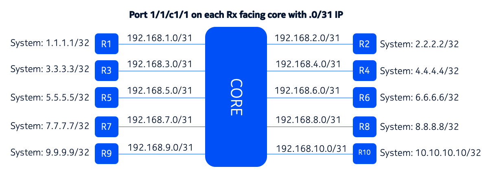

# SR OS Workshop

## Topology



## Configure Ports

```bash
/configure port 1/1/c1 admin-state enable connector breakout c1-100g
/configure port 1/1/c1/1 admin-state enable
```

Compare and commit

## Configure Interface

Replace X in IP address with your router number

```bash
/configure router "Base" interface "to-core" port 1/1/c1/1
/configure router "Base" interface "to-core" ipv4 primary address 192.168.X.0 prefix-length 31
```

Compare and commit

## Configure System Loopback

Replace IP with the correct System loopback IP of your router based on the topology.

```bash
/configure router interface "system" ipv4 primary address X.X.X.X prefix-length 32
```

Compare and commit

### Verify Port and Interface status

```bash
show port
```

```bash
show router interface
```

Ping the core interface IP

Replace X in IP address with your router number

```bash
ping 192.168.X.1
```

## Configure BFD

```bash
/configure router interface "to-core" ipv4 bfd admin-state enable
```

## Configure ISIS

```bash
/configure router isis admin-state enable area-address 49.0000
/configure router "Base" isis 0 interface "system" passive true
/configure router "Base" isis 0 interface "system" interface-type point-to-point
/configure router "Base" isis 0 interface "to-core" interface-type point-to-point
```

Compare and commit

### Verify ISIS status

```bash
show router isis adjacency
```

```bash
show router isis database
```

## Enable BFD for ISIS

```bash
/configure router isis interface "to-core" bfd-liveness ipv4
```

### Verify BFD status

```bash
show router bfd session
```

## Configure SR-MPLS

Replace X in SID index with your router number

```bash
/configure router "Base" mpls-labels sr-labels start 21000
/configure router "Base" mpls-labels sr-labels end 22000
/configure router "Base" isis 0 advertise-router-capability as
/configure router "Base" isis 0 traffic-engineering true
/configure router "Base" isis 0 segment-routing admin-state enable
/configure router "Base" isis 0 segment-routing prefix-sid-range global
/configure router "Base" isis 0 interface "system" ipv4-node-sid index X
```

Compare and commit

### Verify SR-MPLS

```bash
show router tunnel-table
```

```bash
tools dump router segment-routing tunnel
```

## Configure BGP

```bash
/configure router "Base" autonomous-system 64500
/configure router "Base" bgp group "edge" type internal
/configure router "Base" bgp group "edge" peer-as 64500
/configure router "Base" bgp neighbor "100.100.100.100" group "edge"
```

Compare and commit

### Verify BGP status

```bash
show router bgp summary
```

```bash
show router bgp neighbor "100.100.100.100" advertised-routes ipv4
```

```bash
show router route-table
```

## Configure BGP Policies

Create a loopback and advertise it in BGP.

Replace X in loopback IP with your router number.

```bash
/configure router "Base" interface "my-loopback" ipv4 primary address 22.X.22.X prefix-length 32
/configure router "Base" interface "my-loopback" loopback

/configure { policy-options community "COM-TR" member "65535:100" }
/configure { policy-options prefix-list "loopbacks" prefix 22.X.22.X/32 type exact }

/configure policy-options policy-statement "policy-tr" entry-type named
/configure { policy-options policy-statement "policy-tr" insert named-entry "CUST A" beginning }
/configure policy-options policy-statement "policy-tr" named-entry "CUST A" from prefix-list ["loopbacks"]
/configure policy-options policy-statement "policy-tr" named-entry "CUST A" from protocol name [direct]
/configure policy-options policy-statement "policy-tr" named-entry "CUST A" action action-type accept
/configure policy-options policy-statement "policy-tr" named-entry "CUST A" action community add ["COM-TR"]

/configure router "Base" bgp neighbor "100.100.100.100" export policy ["policy-tr"]
```

### Verify BGP Policy

The policy is applied to export the loopback IP to the Core device.

Check the list of advertised routes to the Core neighbor.

```bash
show router bgp neighbor "100.100.100.100" advertised-routes
```

Check the RIB-OUT to see the detailed of the advertised route and make sure the community value is added.

Replace X in the IP with your router number.

```bash
show router bgp routes 22.X.22.X ipv4 hunt
```

## Enable NETCONF

Enable NETCONF listen mode. Default port is 830.

Enable config auto save when commit is done via NETCONF

```bash
/configure system management-interface netconf auto-config-save true
/configure system management-interface netconf listen admin-state enable
/configure system management-interface netconf listen port 830
```

Enable NETCONF RPCs under user profile:

Example is for `administrative` profile which is default.

```bash
/configure system security aaa local-profiles profile "administrative" netconf base-op-authorization action true
/configure system security aaa local-profiles profile "administrative" netconf base-op-authorization cancel-commit true
/configure system security aaa local-profiles profile "administrative" netconf base-op-authorization close-session true
/configure system security aaa local-profiles profile "administrative" netconf base-op-authorization commit true
/configure system security aaa local-profiles profile "administrative" netconf base-op-authorization copy-config true
/configure system security aaa local-profiles profile "administrative" netconf base-op-authorization create-subscription true
/configure system security aaa local-profiles profile "administrative" netconf base-op-authorization delete-config true
/configure system security aaa local-profiles profile "administrative" netconf base-op-authorization discard-changes true
/configure system security aaa local-profiles profile "administrative" netconf base-op-authorization edit-config true
/configure system security aaa local-profiles profile "administrative" netconf base-op-authorization get true
/configure system security aaa local-profiles profile "administrative" netconf base-op-authorization get-config true
/configure system security aaa local-profiles profile "administrative" netconf base-op-authorization get-data true
/configure system security aaa local-profiles profile "administrative" netconf base-op-authorization get-schema true
/configure system security aaa local-profiles profile "administrative" netconf base-op-authorization kill-session true
/configure system security aaa local-profiles profile "administrative" netconf base-op-authorization lock true
/configure system security aaa local-profiles profile "administrative" netconf base-op-authorization validate true
```

Assign profile to user and enable NETCONF access for user.

Example is for `admin` user.

```bash
/configure system security user-params local-user user "admin" access netconf true
/configure system security user-params local-user user "admin" console member ["administrative"]
```

Compare and commit

### Connecting to SR OS using NETCONF

From the VM, run:

```xml
ssh -p 830 admin@<router-name> -s netconf
```

Upon receiving this request, SR OS will respond with list of capabilities in a Hello RPC.

Before sending further RPCs, the user should respond back with a Hello.

```xml
<?xml version="1.0" encoding="UTF-8"?>
<hello xmlns="urn:ietf:params:xml:ns:netconf:base:1.0">
<capabilities>
<capability>urn:ietf:params:netconf:base:1.0</capability>
</capabilities>
</hello>
]]>]]>
```

### Verify current running version

```xml
<?xml version="1.0" encoding="UTF-8"?>
<rpc message-id="101" xmlns="urn:ietf:params:xml:ns:netconf:base:1.0">
  <get>
    <filter type="subtree">
      <state xmlns="urn:nokia.com:sros:ns:yang:sr:state">
        <system>
          <version>
            <version-string/>
          </version>
        </system>
      </state>
    </filter>
  </get>
</rpc>
]]>]]>
```

### Verify BGP config using GET:

```xml
<?xml version="1.0" encoding="UTF-8"?>
<rpc message-id="101" xmlns="urn:ietf:params:xml:ns:netconf:base:1.0">
<get-config>
  <source>
    <candidate/>
  </source>
  <filter>
    <configure xmlns="urn:nokia.com:sros:ns:yang:sr:conf">
      <router>
        <bgp/>
      </router>
    </configure>
  </filter>
</get-config>
</rpc>
]]>]]>
```

### Add a new BGP neighbor

```xml
<?xml version="1.0" encoding="UTF-8"?>
<rpc message-id="0" xmlns="urn:ietf:params:xml:ns:netconf:base:1.0" xmlns:yang="urn:ietf:params:xml:ns:yang:1">
    <edit-config>
        <target><candidate/></target>
        <config>
            <configure xmlns="urn:nokia.com:sros:ns:yang:sr:conf" xmlns:nc="urn:ietf:params:xml:ns:netconf:base:1.0" xmlns:nokia-attr="urn:nokia.com:sros:ns:yang:sr:attributes">
                <router>
                    <router-name>Base</router-name>
                    <bgp>
                        <neighbor>
                            <ip-address>55.55.55.55</ip-address>
                            <group>edge</group>
                        </neighbor>
                    </bgp>
                </router>
            </configure>
        </config>
    </edit-config>
</rpc>
]]>]]>
```

### Commit via NETCONF

```xml
<?xml version="1.0" encoding="UTF-8"?>
<rpc message-id="101" xmlns="urn:ietf:params:xml:ns:netconf:base:1.0">
  <commit> 
  </commit>
</rpc>
]]>]]>
```

Run the previous GET config RPC to verify if the BGP neighbor has been created.

### Disconnect NETCONF session

```xml
<?xml version="1.0" encoding="UTF-8"?>
<rpc message-id="101" xmlns="urn:ietf:params:xml:ns:netconf:base:1.0">
  <close-session/>
</rpc>
]]>]]>
```

## Enable gNMI

```bash
/configure system grpc admin-state enable
/configure system grpc allow-unsecure-connection
/configure system grpc gnmi admin-state enable
/configure system grpc gnmi auto-config-save true
/configure system security user-params local-user user "admin" access grpc true
/configure system security aaa local-profiles profile "administrative" grpc rpc-authorization gnmi-capabilities permit
/configure system security aaa local-profiles profile "administrative" grpc rpc-authorization gnmi-get permit
/configure system security aaa local-profiles profile "administrative" grpc rpc-authorization gnmi-set permit
/configure system security aaa local-profiles profile "administrative" grpc rpc-authorization gnmi-subscribe permit
```

Compare and commit (config is already pushed by Containerlab by default)

### Connecting to SR OS using gNMI

Install `gnmic` if not installed

```bash
bash -c "$(curl -sL https://get-gnmic.openconfig.net)"
```

Check gNMI capabilities

Replace password with the correct value

```bash
gnmic -a r1 -u admin -p <password> --insecure cap
```

Check gNMI GET

```bash
gnmic -a r1 -u admin -p <password> --insecure get --path /configure/port[port-id=1/1/c1/1]
```

Check gNMI SET

```bash
gnmic -a r1 -u admin -p <password> --insecure set --update-path /configure/port[port-id=1/1/c1/1]/description --update-value "SROS workshop gNMI test"
```

Run the previous GET request to verify if the description is set.

Check gNMI GET for STATE datastore

```bash
gnmic -a r1 -u admin -p <password> --insecure get --path /state/port[port-id=1/1/c1/1]/statistics
```

Check gNMI Subscribe

```bash
gnmic -a r1 -u admin -p <password> --insecure sub --stream-mode sample --sample-interval 10s --path /state/port[port-id=1/1/c1/1]/statistics/in-octets
```

Check gNMI Subscribe ON-CHANGE

```bash
gnmic -a r1 -u admin -p <password> --insecure sub --stream-mode on-change --path /state/router[router-name=Base]/bgp/neighbor[ip-address=100.100.100.100]/statistics/session-state
```

This request is monitoring the BGP neighbor state. Login to the router and shutdown the BGP neighbor

```bash
/configure router bgp neighbor "100.100.100.100" admin-state disable
```

Commit

Verify gNMI messages.

Enable the neighbor and verify the gNMI messages.


```bash
/configure router bgp neighbor "100.100.100.100" admin-state enable
```

Commit
